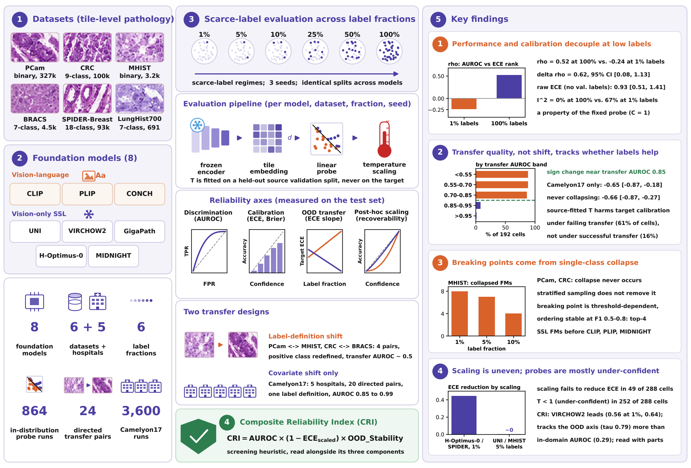

# PRISM: Pathology Reliability In Scarce-label Medicine

**A Tile-level Benchmark of Pathology Foundation Models**

Alicem Koyun, Westcliff University. NeurIPS 2026 Workshop on GenAI for Health (poster).

<p align="center">
  
</p>

<p align="center">
  
  
  
  
  
  
</p>

PRISM measures the **reliability** of pathology foundation models (FMs) at
tile level under label scarcity and distribution shift: discrimination,
calibration before and after temperature scaling, behaviour at low label
budgets, and out-of-distribution transfer, all under one fixed frozen-embedding
linear-probe protocol.

> [THUNDER](https://github.com/MICS-Lab/thunder) tells you which FM performs best. PRISM tells you when that ranking stops predicting whether the model's probabilities can be trusted, under a stated evaluation pipeline.

## Installation

```bash
# from PyPI
pip install prism-bench

# from GitHub
pip install git+https://github.com/alicemkyn/prism-benchmark.git

# from a local checkout (development)
git clone https://github.com/alicemkyn/prism-benchmark.git && cd prism-benchmark
pip install -e ".[test]"
python -m pytest -q
```

The package ships a copy of the corrected reference results (`results_v2`), so
`compare()` works directly after `pip install` without cloning the repository
(see [Reference results](#reference-results)).

## How It Works

PRISM evaluates eight foundation models on six tile-level histopathology
datasets (PCam, MHIST, CRC, BRACS, LungHist700, SPIDER-Breast) at six label
fractions from 1% to 100% with three seeds (864 in-distribution probe runs, 288
model × dataset × fraction cells), plus 24 directed transfer pairs, using a
frozen-embedding linear-probe protocol. Camelyon17 is used as an additional
five-hospital covariate-shift study rather than as a seventh dataset in the
main grid.

The transfer pairs come in two kinds, and that distinction turns out to matter
more than the presence of shift itself:

- **4 label-definition-shift pairs** (PCam↔MHIST, CRC↔BRACS) where the positive
  class is redefined across the pair as well as the acquisition conditions
  changing
- **20 covariate-shift pairs** from Camelyon17, where five hospitals share one
  binary task and one label definition and only the scanner, staining protocol
  and patient population differ

The protocol:

1. You extract embeddings from your model for any of the PRISM datasets
2. PRISM draws class-stratified subsets at 6 label fractions (1%, 5%, 10%, 25%, 50%, 100%) with 3 random seeds
3. At each fraction a logistic-regression probe (C = 1, fixed) is trained; PRISM computes AUROC, macro-F1, ECE (fixed and adaptive binning), Brier score (binary tasks), temperature scaling on a held-out validation split, and the Composite Reliability Index (CRI)
4. Results are compared against 8 reference models (CLIP, PLIP, CONCH, VIRCHOW2, UNI, GigaPath, H-Optimus-0, MIDNIGHT)

<p align="center">
  
</p>

Embeddings are extracted once; PRISM samples label fractions automatically and
everything after extraction runs on CPU.

## Quick Start

```python
import numpy as np
from prism_bench import PRISMEvaluator

# 1. Extract embeddings from your model (any way you want), L2-normalised
#    as in the reference runs.  X_*: (N, D) float arrays, y_*: (N,) int labels.

# 2. Evaluate (val split is required for temperature scaling and CRI)
ev = PRISMEvaluator(results_dir="results_v2")   # or PRISMEvaluator() for the bundled copy
res = ev.evaluate(X_train, y_train, X_test, y_test,
                  dataset="pcam", model_name="MyFM",
                  val_features=X_val, val_labels=y_val)

# 3. Compare against the 8 reference models at 10% labels
cmp = ev.compare(res, dataset="pcam", fraction=0.1)
print(cmp)   # ranked by Composite Reliability Index (CRI)
```

This is the snippet in Appendix E of the paper; `tests/test_end_to_end.py`
runs it verbatim on synthetic embeddings.

## Pre-computed embeddings (Hugging Face)

Pre-computed embeddings for the released FM x dataset cells are distributed
through Hugging Face Datasets (gated: click-through agreement, non-commercial research):

**https://huggingface.co/datasets/alicemkyn/PRISM-embeddings**

Released: CLIP, PLIP, GigaPath, H-Optimus-0 and MIDNIGHT on PCam, CRC, BRACS,
LungHist700, SPIDER-Breast and Camelyon17 (300 `.npy` files, 14.3 GB, plus parquet
copies loadable with `datasets`). MHIST (research-use agreement) and UNI, CONCH,
VIRCHOW2 (CC-BY-NC-ND model licences) are not redistributed; `checksums.csv` on the
Hub lists their SHA256 and numerical fingerprints so a local re-extraction can be
verified with `embeddings_release/code/extract_embeddings.py verify`.

```python
from huggingface_hub import snapshot_download
path = snapshot_download(repo_id="alicemkyn/PRISM-embeddings", repo_type="dataset",
                         allow_patterns=["embeddings/gigapath/bracs/*"])
```

Redistribution follows each source dataset's and model's licence. Released as
embeddings: PCam, CRC, BRACS, LungHist700, SPIDER-Breast and Camelyon17 from
CLIP, PLIP, GigaPath, H-Optimus-0 and MIDNIGHT. Recipe-only (extraction guide,
split indices and checksums, no features): MHIST for every model, and UNI, CONCH,
VIRCHOW2 for every dataset. The reasoning per cell is in `RELEASE_POLICY.md` on
the Hub and in `embeddings_release/`.

## Foundation Models

<details>
<summary><b>List of HuggingFace URLs (click to expand)</b></summary>

| Model | Type | Size | License | HuggingFace |
|---|---|---|---|---|
| CLIP | Vision-Language | 86M | MIT | [openai/clip-vit-base-patch32](https://huggingface.co/openai/clip-vit-base-patch32) |
| PLIP | Vision-Language | 86M | Custom | [vinid/plip](https://huggingface.co/vinid/plip) |
| CONCH | Vision-Language | 86M | CC-BY-NC-ND 4.0 | [MahmoodLab/CONCH](https://huggingface.co/MahmoodLab/CONCH) |
| UNI | Vision | 307M | CC-BY-NC-ND 4.0 | [MahmoodLab/UNI](https://huggingface.co/MahmoodLab/UNI) |
| VIRCHOW2 | Vision | 632M | CC-BY-NC-ND 4.0 | [paige-ai/Virchow2](https://huggingface.co/paige-ai/Virchow2) |
| GigaPath | Vision | 1.1B | Microsoft Research License | [prov-gigapath/prov-gigapath](https://huggingface.co/prov-gigapath/prov-gigapath) |
| H-Optimus-0 | Vision | 1.1B | Apache 2.0 | [bioptimus/H-optimus-0](https://huggingface.co/bioptimus/H-optimus-0) |
| MIDNIGHT | Vision | 1.1B | MIT | [kaiko-ai/midnight](https://huggingface.co/kaiko-ai/midnight) |

</details>

**Preprocessing on the six main datasets.** The in-distribution extraction
notebooks (`notebooks/<dataset>/`) do not use a single shared transform:
GigaPath uses Resize 256 + CenterCrop 224, H-Optimus-0 uses its own
normalisation statistics, CONCH uses the transform returned by its own
`create_model_from_pretrained`, and CLIP, PLIP, UNI, VIRCHOW2 and MIDNIGHT use
Resize 224 + CenterCrop 224 with ImageNet statistics (for CLIP, PLIP and
MIDNIGHT this differs from their documented transforms). Features are
L2-normalised. Camelyon17 uses each model's own documented transform
(`data/camelyon17/preprocessing_table.csv`).

## Datasets

<details>
<summary><b>List of dataset sources (click to expand)</b></summary>

| Dataset | Task | Classes | Samples | License | Source |
|---|---|---|---|---|---|
| PCam | Binary (tumor) | 2 | 327K | CC0 | [basveeling/pcam](https://github.com/basveeling/pcam) |
| CRC | Multiclass | 9 | 100K (NCT-CRC-HE-100K) | CC-BY 4.0 | [Zenodo 1214456](https://zenodo.org/records/1214456) |
| MHIST | Binary (HP/SSA) | 2 | 3.2K | Custom (RUA) | [bmirds/MHIST](https://bmirds.github.io/MHIST/) |
| BRACS | Multiclass | 7 | 4.5K | CC-BY-NC 4.0 | [bracs.icar.cnr.it](https://www.bracs.icar.cnr.it/) |
| LungHist700 | Multiclass | 7 | 691 | CC-BY 4.0 | [Figshare](https://figshare.com/articles/dataset/LungHist700/24264394) |
| SPIDER-Breast | Multiclass | 18 | 92.9K | CC-BY-NC 4.0 | [histai/SPIDER-breast](https://huggingface.co/datasets/histai/SPIDER-breast) |
| Camelyon17 | Binary (tumor), 5 hospitals | 2 | 456K | CC0 | [WILDS](https://wilds.stanford.edu/datasets/) |

Camelyon17 is used for the covariate-shift transfer study rather than as a
seventh dataset in the main in-distribution grid. We sample 20,000
label-stratified patches per hospital; split indices and the balanced re-split
index map are in `data/camelyon17/`.

</details>

## API Reference

### PRISMEvaluator

```python
from prism_bench import PRISMEvaluator
ev = PRISMEvaluator(results_dir=None)
```

`results_dir` selects the reference results used by `compare()` and
`reference_cri()`:

| value | reference used |
|---|---|
| `None` (default) | `results_v2` copy bundled with the package (`prism_bench/reference/`) |
| `"results_v2"` / path to a `results_v2` directory / repository root | that directory (`indomain_all_v2.csv`, `ood_all_v2.csv`). If a path named `results_v2` does not exist, the bundled copy is used with a warning |
| path to legacy `results/` | as-submitted v1 per-file layout, accepted with a warning for traceability only; **not** the numbers in the paper |

`evaluate()` does not need reference results.

### evaluate()

```python
results = ev.evaluate(
    train_features,   # np.ndarray (N, D) - training embeddings
    train_labels,     # np.ndarray (N,)   - integer class labels
    test_features,    # np.ndarray (M, D) - test embeddings
    test_labels,      # np.ndarray (M,)   - integer class labels
    dataset,          # str - e.g. "pcam"
    model_name,       # str - display name (default: "CustomModel")
    val_features,     # np.ndarray (V, D) - validation embeddings (needed for TS / CRI)
    val_labels,       # np.ndarray (V,)   - validation labels
    label_fractions,  # list of floats (default: [0.01, 0.05, 0.10, 0.25, 0.50, 1.00])
    seeds,            # list of ints (default: [42, 123, 456])
    C,                # float, logistic-regression C (PRISM protocol: 1.0)
)
```

Returns `pd.DataFrame` with columns: `model, dataset, fraction, seed, n_train, n_classes, auroc, f1_macro, brier, ece_fixed, ece_adaptive, temperature, ece_scaled_fixed, ece_scaled_adaptive, degeneracy_share, forced_classes, degenerate`

Works on **any dataset**.

**Validation split.** Temperature scaling requires held-out data. Without
`val_features` the temperature and both scaled-ECE columns are `NaN` and a
warning is raised; CRI cannot be computed. PRISM never falls back to fitting
the temperature on the evaluation set, since that gives an oracle estimate
rather than a deployable one.

**Label budget.** The label fraction subsamples the training split only. A
validation split used for temperature fitting is a separate budget, and at low
fractions it dominates: at 1% labels on Camelyon17 a cell uses 140 training and
3,000 validation labels. `results_v2/camelyon17_label_budget.csv` and
`results_v2/label_budget_accounting.csv` report the realised budget per cell,
and both full and proportional validation protocols are reported alongside each
other.

**Degeneracy.** At low label fractions a linear probe often assigns every test
sample to a single class. `degeneracy_share` reports the share of test samples
in the most-predicted class; near 1.0 means F1 and ECE describe a degenerate
classifier even where AUROC still looks reasonable.

### compare()

```python
comparison = ev.compare(
    custom_results,         # pd.DataFrame from evaluate()
    dataset,                # one of the 6 PRISM datasets ('pcam', 'PCam', 'spider_breast',
                            # 'SPIDER-Breast', ...) or 'all' to pool the six datasets
    fraction,               # float or None
    ece_column="ece_scaled_fixed",
    aggregation="multiplicative",
    custom_ood_stability=None,   # your model's OOD_Stability, if measured
)
```

Returns a `pd.DataFrame` sorted by CRI with columns `model, fraction, auroc,
ece, ece_scaled, ood_stability, ood_stability_imputed, cri, is_reference`.
Reference rows are means over seeds of `results_v2/indomain_all_v2.csv`. An
unseen model has no measured transfer performance, so unless
`custom_ood_stability` is given its OOD_Stability is set to the mean of the
eight reference models and flagged `ood_stability_imputed=True`.

`compare()` requires embeddings from one of the six main PRISM datasets;
`evaluate()` works on any dataset.

### reference_cri()

```python
ev.reference_cri(fraction=1.0)    # reproduces results_v2/cri_variants_100.csv
ev.reference_cri(fraction=0.01)   # reproduces results_v2/cri_variants_1.csv
```

Model-level CRI of the eight reference FMs pooled over the six datasets, under
all four aggregation rules.

### Standalone metric functions

```python
from prism_bench import (compute_auroc, compute_ece, compute_brier,
                         compute_cri, compute_ood_stability,
                         temperature_scale, apply_temperature)

auroc  = compute_auroc(labels, probs)
ece_f  = compute_ece(probs, labels, n_bins=15, binning="fixed")
ece_a  = compute_ece(probs, labels, n_bins=15, binning="adaptive")
brier  = compute_brier(labels, probs)

T      = temperature_scale(val_logits, val_labels)   # held-out split only
scaled = apply_temperature(test_logits, T)

stab = compute_ood_stability(
    ood_aurocs={("pcam", "mhist"): 0.62},   # (source, target) -> OOD AUROC
    id_aurocs={"pcam": 0.98},               # source -> in-distribution AUROC
)
cri  = compute_cri(auroc, ece_scaled, stab, aggregation="multiplicative")
```

### Metrics

| Metric | Description |
|---|---|
| AUROC | Area under ROC curve (macro one-vs-rest for multiclass) |
| ECE | Expected Calibration Error, 15 bins, fixed-width or equal-mass (`binning="adaptive"`). Binary tasks: positive-class calibration, p(class 1) vs. label. Multiclass: top-label confidence vs. accuracy |
| Brier | Brier score (binary tasks; `NaN` for multiclass) |
| ece_scaled | ECE after temperature scaling fitted on the held-out validation split; clipped to [0, 1] in the CRI |
| temperature | Fitted T. T > 1 softens the probe's probabilities (the probe was over-confident); T < 1 sharpens them (under-confident) |
| OOD_Stability | Mean over the four transfer pairs of OOD AUROC / in-distribution AUROC of the source, clipped to 1, at full supervision. On CRC↔BRACS the numerator is a binary AUROC and the denominator a multiclass macro AUROC |
| CRI | Composite Reliability Index = AUROC × (1 − ECE_scaled) × OOD_Stability |

**Temperature convention.** From v0.3.0, binary logits are built so that T = 1
reproduces the probe's own `predict_proba`. The binary `temperature` column in
`results_v2/` was produced with the earlier convention (logits `[-d, d]`,
i.e. sigmoid(2d)) and is therefore on a doubled scale: divide by 2 to compare.
Scaled probabilities, ECE_scaled and CRI are identical under both conventions.

`compute_cri` also accepts `arithmetic`, `geometric` and `worst_axis`
aggregations. Rankings agree across all four at Kendall tau 0.71–1.00, so the
combination rule does not drive the conclusions.

**The CRI is a screening heuristic computed under the fixed-probe protocol**,
not a measure of clinical readiness. `OOD_Stability` is a ratio and therefore
rewards models with less in-distribution performance to lose (e.g. CLIP ranks
fourth at full supervision with the lowest pooled AUROC). Report the three
components alongside the composite: `results_v2/cri_components.csv` and
`results_v2/camelyon17_cri_components.csv`.

## CLI Reference

```bash
# Evaluate (writes <model>_<dataset>_results.csv unless --output is given)
prism evaluate \
  --train-features X_train.npy \
  --train-labels   y_train.npy \
  --test-features  X_test.npy  \
  --test-labels    y_test.npy  \
  --val-features   X_val.npy   \
  --val-labels     y_val.npy   \
  --dataset        pcam        \
  --model-name     MyModel
  # optional: --label-fractions 0.01,0.1,1.0  --seeds 42,123,456  --C 1.0

# Compare against reference models (default reference: bundled results_v2)
prism compare \
  --results      mymodel_pcam_results.csv \
  --dataset      pcam                     \
  --fraction     0.1                      \
  [--results-dir results_v2] [--ood-stability 0.62] [--aggregation multiplicative]

# Pooled reference CRI of the eight FMs (reproduces results_v2/cri_variants_100.csv)
prism reference --fraction 1.0

prism --version          # python -m prism_bench is equivalent to prism
```

## Supported Datasets

| key | results_v2 name | Task | Classes |
|---|---|---|---|
| pcam | PCam | Binary | 2 |
| mhist | MHIST | Binary | 2 |
| crc | CRC | Multiclass | 9 |
| bracs | BRACS | Multiclass | 7 |
| lunghist700 | LungHist700 | Multiclass | 7 |
| spider_breast | SPIDER-Breast | Multiclass | 18 |
| camelyon17 | (transfer study only) | Binary, 5 hospitals | 2 |

## Reference results

- `results_v2/` contains the corrected results; **every number in the
  camera-ready paper is computed from it**.
- `results/` contains the original files as submitted (v1). It is kept,
  unedited, for traceability; do not use it for numbers.
- `prism_bench/reference/` is a byte-identical copy of the `results_v2` files
  `compare()` needs (`indomain_all_v2.csv`, `ood_all_v2.csv`) plus the CRI
  regression targets; it is installed with the package, so
  `PRISMEvaluator()` works without a checkout.

## Repository Structure

```
prism-benchmark/
├── notebooks/
│   ├── PRISM_bootstrap_ci.ipynb
│   ├── PRISM_analysis_v2.ipynb              # Main analysis, 7 figures
│   ├── PRISM_OOD_analysis.ipynb             # OOD analysis, 3 figures
│   ├── PRISM_rebuttal_phase1.ipynb          # Corrected re-computation (results_v2)
│   ├── PRISM_rebuttal_phase3_peft.ipynb     # LoRA ablation (36 runs)
│   ├── PRISM_rebuttal_mlp_probe.ipynb       # MLP probe, in-distribution
│   ├── PRISM_rebuttal_ood_mlp.ipynb         # MLP probe, transfer
│   ├── PRISM_rebuttal_ood_c_ablation.ipynb  # Regularisation sweep, transfer
│   ├── PRISM_rebuttal_round2.ipynb          # Threshold sweep, seed variability
│   ├── PRISM_rebuttal_propval.ipynb         # Proportional label budget
│   ├── PRISM_camelyon17_extract.ipynb       # Camelyon17 embeddings (GPU)
│   ├── PRISM_camelyon17_transfer.ipynb      # 20 hospital pairs (CPU)
│   ├── PRISM_mechanism.ipynb                # Transfer-quality analysis
│   ├── PRISM_camelyon17_figures.ipynb       # Figures for the extension
│   ├── 00_Setup_Datasets.ipynb              # Dataset setup
│   ├── Pcam/ bracs/ crc/ mhist/ lunghist700/ spider_breast/
│   │                                        # 8 feature-extraction notebooks each
│   ├── ood_embeddings_notebooks/            # GPU-free OOD evaluation notebooks
│   │                                        # (produced every reported OOD result)
│   └── ood_notebooks/                       # Superseded GPU implementation, kept
│                                            # for completeness; produced none of
│                                            # the reported results
├── data/camelyon17/                         # Split indices, balanced re-split map,
│                                            # preprocessing table
├── figures/                                 # Figures
├── results/                                 # v1, as submitted (do not use for numbers)
├── results_v2/                              # Corrected re-run and all later analyses
├── supplementary/
├── prism_bench/
│   ├── __init__.py
│   ├── metrics.py                           # AUROC, ECE, Brier, CRI, temperature
│   ├── evaluator.py                         # PRISMEvaluator class
│   ├── cli.py                               # prism CLI
│   └── reference/                           # bundled results_v2 reference CSVs
├── tests/test_end_to_end.py                 # pytest, synthetic embeddings
├── scripts/build_pypi.sh                    # build + twine check (upload commented)
├── pyproject.toml
└── setup.py                                 # shim; metadata in pyproject.toml
```

## Key Findings

All statements below are measured under the PRISM protocol (frozen embeddings,
logistic-regression probe with fixed C = 1, temperature fitted on a held-out
validation split) and computed from `results_v2/`. They describe the
behaviour of this evaluation pipeline, not intrinsic properties of the
foundation models.

1. **Discrimination and calibration rankings decouple at low label budgets,
   and this is a property of the fixed-probe evaluation pipeline.** Pooled
   across datasets (seed-averaged cells), the Spearman correlation between
   AUROC rank and temperature-scaled calibration rank is −0.24 at 1% labels
   and +0.52 at full supervision. The conservative seed-level bootstrap
   (resampling datasets and one seed per cell,
   `results_v2/rank_correlations_seedlevel.csv`) gives −0.10 and +0.52,
   Δρ = 0.62, 95% CI [0.08, 1.13], which still excludes zero. On CRC every model exceeds AUROC 0.977 at 1% labels while raw
   ECE ranges from 0.18 to 0.37. The calibration ranking is protocol-dependent:
   varying the probe's regularisation constant leaves the AUROC ranking
   essentially intact (mean Kendall tau 0.82) while scrambling the calibration
   ranking (tau 0.02, 16 sign inversions in 36 comparisons), and an MLP probe
   reproduces the asymmetry (0.85 against 0.29). Under transfer both rankings
   survive (0.71 and 0.59).

2. **The direction of miscalibration depends on task type.** On the four
   multiclass datasets the probe is *under*-confident: the fitted temperature
   is below 1 in 189 of 192 (model, dataset, fraction) cells (98%), e.g.
   T = 0.28–0.40 on SPIDER-Breast and 0.29–0.43 on CRC at 1% labels, so the
   high raw ECE there reflects probabilities that are too soft, not too sharp.
   On the two binary datasets (PCam, MHIST) the `results_v2` temperature
   exceeds 1 in all 96 cells, but that column uses a doubled-logit convention
   (see [Metrics](#metrics)); on the probe's own logit scale the binary probes
   are close to calibrated (median T ≈ 0.99 on PCam, 0.86 on MHIST) and
   over-confident (T > 1) in 33 of 96 cells.

3. **Temperature scaling is not uniformly effective.** It removes up to 0.45
   of ECE (H-Optimus-0 on SPIDER-Breast at 1% labels, 0.465 → 0.020), yet fails
   to reduce ECE in 49 of 288 in-distribution cells (MHIST 16, PCam 13,
   LungHist700 11, BRACS 5, SPIDER-Breast 4).

4. **Whether more source labels help or harm target calibration tracks
   transfer quality, not the presence of shift.** Across 192 (model, pair)
   combinations from both transfer designs, transfer AUROC is correlated with
   the slope of target ECE against source label fraction (Spearman −0.78; −0.65
   within Camelyon17 alone, where dataset, task and kind of shift are constant;
   −0.66 among the 163 combinations that never collapse to a single class).
   In these settings we observe a transition around a transfer AUROC of 0.85:
   below it, additional source labels worsen target ECE in 86–88% of
   combinations; above it, in 1–8%. The 0.85 value is an empirical,
   correlational observation for these eight models and 24 pairs, not a
   validated or causal threshold.

5. **The two kinds of shift therefore behave in opposite directions.** On the
   four label-definition-shift pairs, target ECE rises with the source label
   fraction in 28 of 32 combinations (mean +0.082). On the twenty Camelyon17
   hospital pairs, where the label definition is fixed, it rises in 10 of 160
   (mean −0.149). CLIP transfers at a mean AUROC of 0.849 across label
   fractions under pure covariate shift and shows the effect in 8 of its 20
   pairs, while the other seven models transfer at 0.97–0.99 and show it in 2
   of 140.

6. **A temperature fitted at the source can hurt under failing transfer.**
   Fitting T on a held-out source validation split worsens target ECE in 61% of
   cells across the four original pairs (for all eight models on MHIST→PCam at
   source fractions ≥ 25% and on CRC→BRACS at ≥ 5%), against 16% on the
   Camelyon17 hospital pairs, where transfer succeeds.

## Practical reading

If target calibration degrades as you add source labels, the probe is likely
not transferring, whatever the shift is called. Measure transfer performance
before collecting more source labels; in our settings, below roughly AUROC 0.85
additional labels made the probabilities worse rather than better.

## Limitations

- Tile-level classification with frozen representations. Conclusions concern
  reliability under these benchmark conditions, not whole-slide diagnosis or
  clinical deployment
- Fixed C = 1 is the main protocol. A regularisation sweep, an MLP-probe
  replication of all 864 in-distribution and 576 transfer cells, and a limited
  LoRA ablation (36 runs: UNI and H-Optimus-0 on MHIST and LungHist700 at three
  label fractions) are included; per-cell tuned C and full fine-tuning are
  outside the protocol (tuned-C replication deferred to a journal version)
- The six main datasets were embedded under model-specific but not uniformly
  documented preprocessing (see [Foundation Models](#foundation-models)), so
  cross-model comparisons on those datasets carry an unquantified confound.
  The Camelyon17 extraction resolves each model's own documented transform
- In-distribution results on Camelyon17 use a patch-level split and are
  reported as an upper bound. Slide-disjoint splitting was rejected because
  tumour concentrates in two or three slides per hospital and left prevalence
  between 0.1% and 83% across partitions (slide-disjoint replication deferred
  to a journal version). Transfer results are unaffected, since source and
  target are different hospitals with disjoint slides
- The CRI is a screening heuristic, not a validated clinical instrument. No
  dataset here carries deployment outcomes, so no correlation with clinical
  outcomes is estimable from this benchmark
- Three seeds per cell. Between-seed variance is largest at 1% labels, up to
  0.055 in AUROC on MHIST, and is reported alongside every low-fraction result

## Citation

```bibtex
@inproceedings{koyun2026prism,
  title     = {{PRISM}: Pathology Reliability In Scarce-label Medicine. A Tile-level Benchmark of Pathology Foundation Models},
  author    = {Koyun, Alicem},
  booktitle = {NeurIPS 2026 Workshop on GenAI for Health},
  year      = {2026},
  url       = {https://github.com/alicemkyn/prism-benchmark}
}
```

## License

MIT License (see `LICENSE`). Pre-computed embeddings and the source datasets
remain subject to their own licences.
